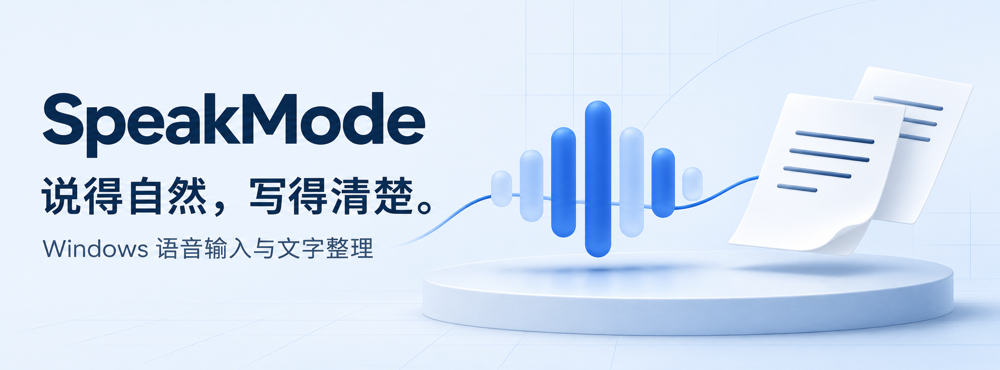
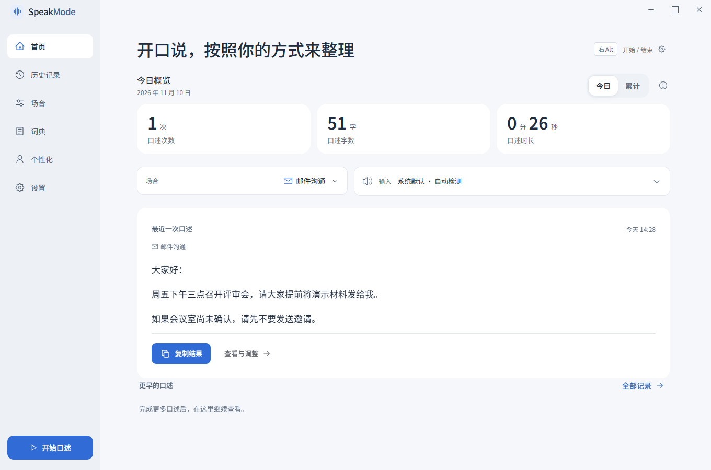
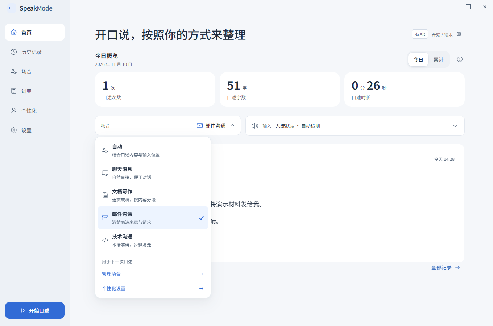
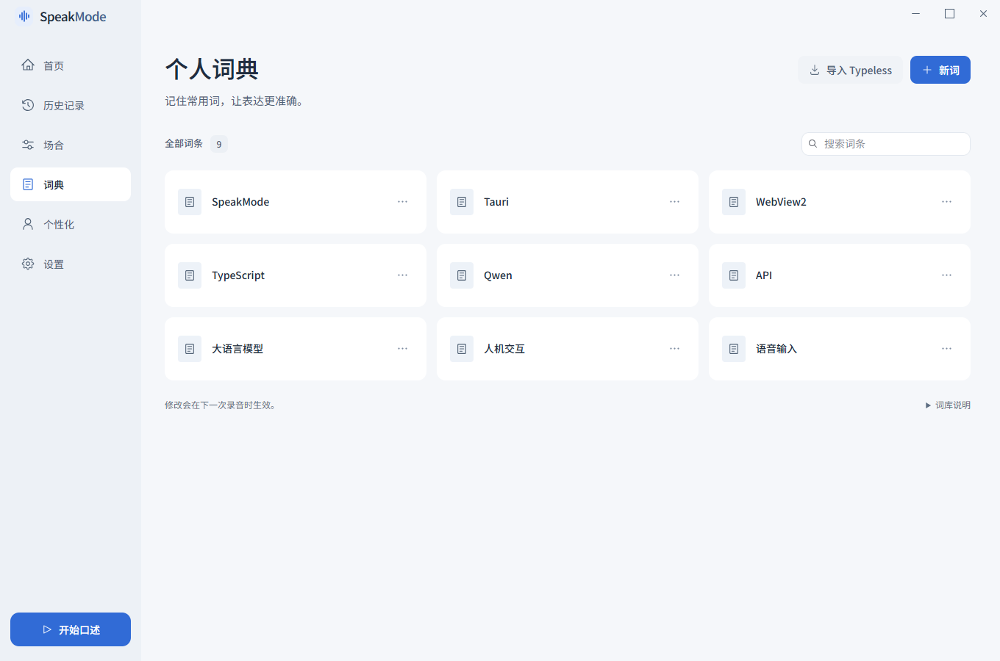
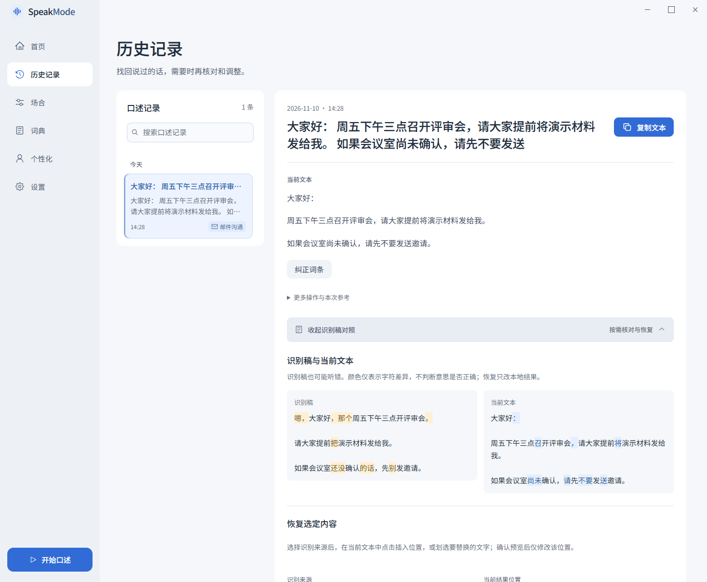
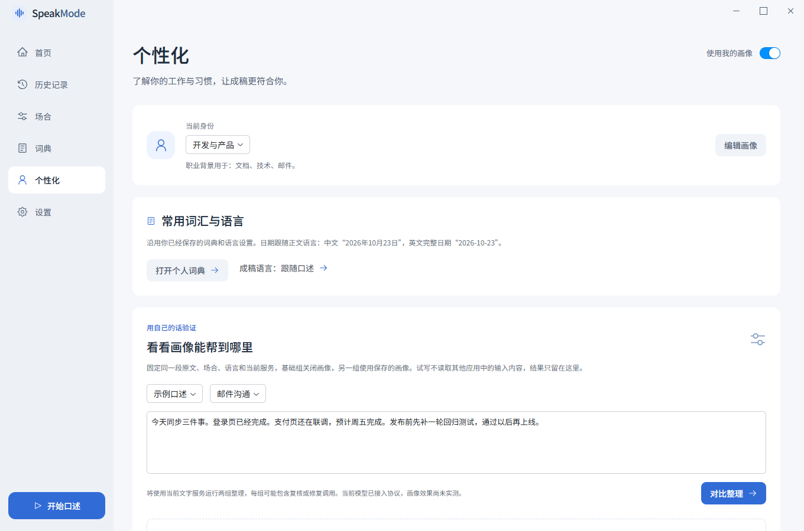
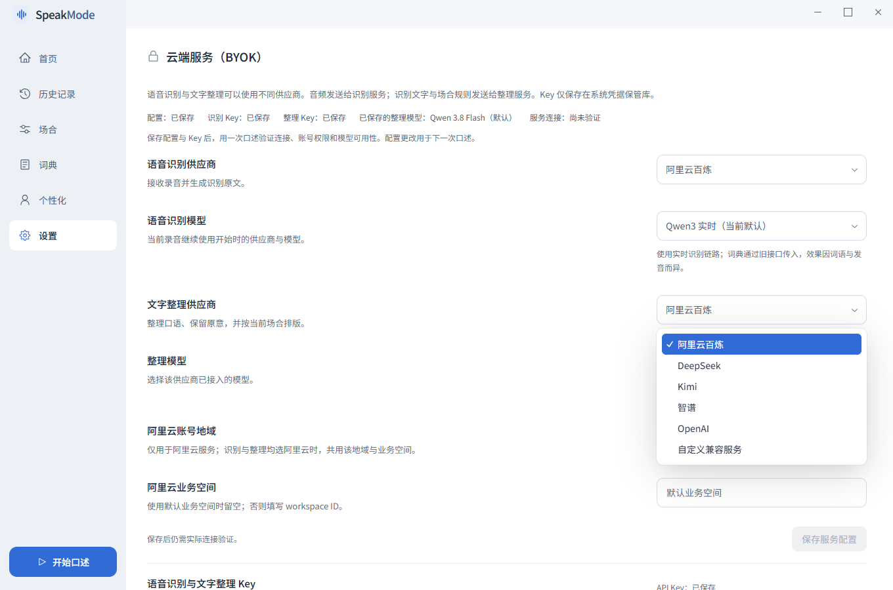

<p align="center">
  
</p>

<p align="center">
  <strong>按一下右 Alt，把自然口述变成可直接使用的文字。</strong><br />
  聊天、文档、邮件、技术讨论，按当前场合整理，再写入你的文本框。
</p>

<p align="center">
  
</p>

<p align="center">
  <a href="https://github.com/13-pieces-teen/speakmode/releases/latest/download/SpeakMode-windows-x64-setup.exe"><strong>下载 Windows x64 安装包</strong></a> ·
  <a href="https://github.com/13-pieces-teen/speakmode/releases/latest">最新版本与更新说明</a><br />
  <a href="#demo">流程演示</a> ·
  <a href="#features">核心优势</a> ·
  <a href="#screenshots">界面一览</a> ·
  <a href="#start">开始使用</a> ·
  <a href="docs/development.md">开发指南</a>
</p>

<a id="demo"></a>

## 从开口到成稿，三步完成

**开始录音 → 录音整理 → 输入文本框**

在要输入的位置按下 <kbd>右 Alt</kbd>，自然地说话；再按一次结束，SpeakMode 整理后尝试自动输入。录音中可以停顿、查资料，也可以调整光标位置。

<p align="center">
  
</p>

<p align="center"><sub>12 秒循环流程示意，使用示例文案与自定义快捷键；默认快捷键为右 Alt，当前界面见下方截图。</sub></p>

<a id="features"></a>

## 为什么用 SpeakMode

| 自然地说，按场合写 | 原话留得住，改动看得见 |
| --- | --- |
| 清理口头语与重复，按聊天、文档、邮件或技术沟通的用途组织文字；也能创建自己的场合规则。 | 保留识别稿与成稿，按需查看差异、恢复选定内容；本地修改支持撤销。 |
| **常用词和表达，由你决定** | **识别与整理，服务自由搭配** |
| 项目名、人名、英文缩写可加入个人词典；在成稿中纠词后，可选择记住这个写法。表达习惯与职业画像按需开启。 | 语音识别与文字整理分别配置供应商、模型和 Key，支持自定义 OpenAI 兼容整理服务。 |

### 同一句话，整理成适合使用的文字

> **口述示例**<br />
> 嗯，大家好，那个周五下午三点开评审会。请大家提前把演示材料发给我。如果会议室还没确认的话，先别发邀请。

**邮件成稿示例**

> 大家好：
>
> 周五下午三点召开评审会，请大家提前将演示材料发给我。
>
> 如果会议室尚未确认，请先不要发送邀请。

<sub>示例用于说明整理目标；实际结果取决于识别内容、所选模型与规则。</sub>

### 让成稿适应你的日常工作

- **五种内置场合**：自动、聊天消息、文档写作、邮件沟通、技术沟通；支持自定义场合。
- **成稿语言独立选择**：跟随口述，或整理为英文成稿。
- **个人词典**：手工维护、批量添加、纠词记忆，也可导入本机已缓存的 Typeless 词表。
- **可选个性化**：设置职业背景、通用表达习惯与场合覆盖，用同一段原文对照试写。
- **紧凑录音浮条**：显示录音与处理状态；实时字幕可在设置中开启。
- **保留可用结果**：有完整识别稿时，整理异常可保留已复核草稿或执行本地基础整理，并标明结果来源；无法自动输入时可复制成稿。

<a id="screenshots"></a>

## 界面一览

最近结果、场合和输入偏好，都在首页。常用操作保持直接，核对与调整按需展开。

<p align="center">
  <a href="docs/assets/readme/home.png"></a>
</p>

<table>
  <tr>
    <td width="50%" align="center"><a href="docs/assets/readme/scenes.png"></a><br /><strong>按场合，调整表达</strong><br /><sub>聊天自然直接，文档连贯清楚，邮件保留请求与条件。</sub></td>
    <td width="50%" align="center"><a href="docs/assets/readme/dictionary.png"></a><br /><strong>常用专名，自己掌握</strong><br /><sub>把常用写法加入词典，供后续录音参考。</sub></td>
  </tr>
</table>

<details>
<summary><strong>展开更多界面：原稿对照、个性化与服务配置</strong></summary>

### 找回原话，也能局部恢复

识别稿与当前文本并排核对，差异按字符标出；需要时选定来源和目标位置，只恢复相应内容。



### 让表达更符合你的习惯

职业背景、表达习惯和作用范围由你设置。可用同一段原文进行基础与个性化对照，再判断是否适合自己。



### 两个阶段，分别选择服务

语音识别可选阿里云百炼或 Google；文字整理可选阿里云百炼、DeepSeek、Kimi、智谱、OpenAI 或自定义兼容服务。



</details>

<sub>截图来自当前生产前端，使用固定示例数据；点击图片可查看原图。[素材来源与制作说明](docs/readme-assets.md)。</sub>

<a id="start"></a>

## 开始使用

从 [GitHub Releases 下载最新 Windows x64 安装包](https://github.com/13-pieces-teen/speakmode/releases/latest/download/SpeakMode-windows-x64-setup.exe)，安装后即可使用，无需配置开发环境。需要自备云服务 API Key；首次使用可跟随应用内引导，完成服务配置、快捷键测试与口述练习。

安装包目前未做 Windows 代码签名，系统可能显示发布者未知或 SmartScreen 提示。首次安装需要联网准备 WebView2 Runtime。升级时重新下载最新版安装包；当前没有应用内自动更新。各版本的更新说明、验证范围与 SHA256 校验文件见 [Release 页面](https://github.com/13-pieces-teen/speakmode/releases/latest)。

### 运行桌面应用

准备 Node.js **22.12+**、npm、支持 edition 2024 的 Rust MSVC 工具链、Microsoft C++ Build Tools / Windows SDK，以及 WebView2 Runtime。

```powershell
git clone --branch fix/dictation-reliability-20261028 --single-branch https://github.com/13-pieces-teen/speakmode.git
cd speakmode/app
npm ci
npm run tauri -- dev --target x86_64-pc-windows-msvc
```

### 配置一次，然后开口

1. 打开 **设置 → 云端服务**，分别选择语音识别与文字整理服务，保存对应的模型和 API Key。
2. 回到首页选择场合，把光标放到要输入的文本框。
3. 按 <kbd>右 Alt</kbd> 开始，再按一次结束；核对文本框中的结果。需要调整时，到历史记录查看、纠词或复制。

供应商的账号权限、地域、模型可用性和费用以你自己的服务配置为准。Google 识别使用录音结束后转写的方式，单次上限为 7 分钟。

### 数据与控制

- API Key 保存在 **Windows Credential Manager**，由原生后端读取。
- 音频发送到你选择的识别服务；识别文字与整理规则发送到你选择的文字整理服务。
- 历史记录在本地管理，可关闭历史保存。个人词典会用于对应识别请求。
- 输入位置感知与职业画像可选开启；启用后，相关参考内容按设置提供给整理服务。
- 自动输入前会复核目标；目标改变或无法确认可写位置时保留结果，供你手动复制。

SpeakMode 持续开发中。识别与整理结果仍需按任务核对，实际应用的输入兼容性也会不同；当前验证范围见[验证记录](docs/validation.md)。

## 开发与参与

界面由 **React 19 + TypeScript + Radix** 构建，**Tauri 2 + Rust** 负责采音、识别、整理、系统输入与本地数据。

| 入口 | 内容 |
| --- | --- |
| [开发指南](docs/development.md) | 运行、检查、测试、打包与代码导航 |
| [构建与缓存管理](docs/build-cache.md) | Windows 构建入口、共享缓存与磁盘预算 |
| [Release 发布流程](docs/releases.md) | 版本标签、自动构建与安装包下载 |
| [首次使用引导](docs/desktop-onboarding.md) | 服务准备、快捷键测试与口述练习 |
| [验证记录](docs/validation.md) | 各项验证的范围与证据 |
| [第三方材料](docs/third-party/README.md) | 第三方代码、资源和许可说明 |

欢迎通过 [Issues](https://github.com/13-pieces-teen/speakmode/issues) 反馈使用问题或提出改进建议。描述场合、实际表现和期望结果，有助于复现与讨论。

---

<sub>第三方代码和资源遵循各自随附许可证。本仓库尚未声明第一方开源许可证。</sub>
