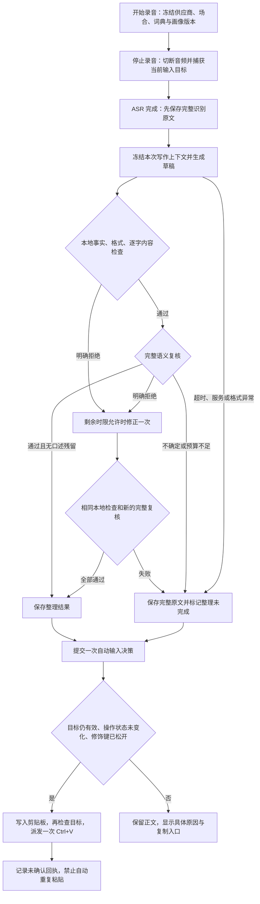

# 自动输入与整理失败修复（2026-10-28）

用户反馈：多个应用中自动输入没有发生，但手动 Ctrl+V 可以；有时只能得到识别稿，没有自动整理。两类问题需要分别记录：文本没有写入目标，不等于模型没工作；正文已保存，也不等于整理或粘贴成功。

## 当前证据与结论

本轮只读检查本机 SQLite 的状态、类别和计数，没有读取或导出识别正文、成稿、录音、聊天或凭据。66 份初始输出中，49 份未标记回退，16 份因 `meaningRisk` 回退，1 份因 `timeout` 回退。这里的 49/66 只代表没有回退标记，不是人工质量通过率；16 份还不能细分为本地规则误拦截或模型实际改错。

63 次自动输入决策中，7 次 `targetNotEditable`、4 次 `targetChangedBeforeDelivery`、52 次 `inputDispatchedUnconfirmed`。最后一项只能证明派发流程完成，无法据此判定目标是否插入；这份统计也不包含应用归属，不能计算微信或浏览器的成功率。聚合证据在仓库外 `output/dictation-metadata-20261028.json`，不将个人数据库纳入 Git。

已修复可在代码和测试中确认的缺陷：自定义可写控件被类型过滤、键盘路径二次验证切换检测方式导致误判、原生按键事件未携带扫描码、验证失败原因被统一写成焦点变化，以及整理被拒绝后缺少完整的纠正机会。它们是与症状相关的工程缺陷；尚未证明它们解释了用户每一次实际失败。

## 整体流程

此图描述正常初次口述和新增完整修正分支。原有句内口癖修补仍可在严格字节级删除证明成立时免去第二次模型复核；新增完整修正始终需要新的全文复核。取消、源文不完整、保存未确认、过期会话或画像撤销不能通过原文回退继续交付；历史重试、采用候选稿也不会重新获得旧输入位置的自动粘贴许可。预览及 onboarding 结果只留在应用中。

### 输入目标与粘贴

1. 先检查原生编辑控件或 UIA 精确选区。能力不足时，自动使用明确可写、拥有键盘焦点且身份稳定的控件；本轮补充 `Custom` 类型。未知只读状态、密码框、按钮和不可确认的窗口继续拒绝。用户不需要选择兼容模式。
2. 停止录音选定键盘路径后，后续验证沿用该路径和原始操作计数。UIA 后来开始提供 TextPattern，不再仅因快照结构改变而被认成换了输入框；窗口、进程生命周期、焦点、运行时控件身份和用户操作仍须匹配。
3. Ctrl+V 按目标线程的键盘布局映射扫描码，正常批次只有四个事件。映射缺失时使用原有逻辑键，部分派发只释放按键，不再发第二次 V-down。此处依据 [Microsoft KEYBDINPUT 文档](https://learn.microsoft.com/windows/win32/api/winuser/ns-winuser-keybdinput)。
4. 复制前后都重新验证，持久化的单次许可在原生输入前提交。点击、滚动、键入、换焦点或取消会中止；悬停移动和停止手势的松开不会单独使旧目标失效。
5. 失败回执保留固定原因，如输入操作变化、控件能力不足、检查超时或权限不同。没有读到插入结果时仍写 `unconfirmed`，不将 SendInput 返回 4 解释为目标已收到文本。

缺少精确选区接口时仍无法证明应用内部程序性光标移动不存在。窗口级例外仍只覆盖此前观察到的微信窗口族，本轮未扩大为任意窗口。模型输入上下文也不会因为键盘路径可投递就自动变成“可读取”。

### 整理、复核与回退

自动整理沿用现有路由：明确场合／冻结写作上下文与已启用的 minimum 路由采用本轮修正流程，其他旧协议保持各自行为。正常成功仍是生成与复核两次请求。

之前只能修补有限的句内口述残留；遇到信息遗漏、条件改变等不能用句内替换表示的问题，直接回退。现在增加 `minimum-correction-v1`：

- 只允许一次修正。优先保留既有句内修补；无法表达修补且复核明确失败时，才重新生成完整草稿。`uncertain` 不触发猜测式重写。
- 修正请求复用原始 source、mode、字典保护标记、场合和画像快照。旧草稿及固定检查标签是数据，不会变成事实来源或新增指令；没有把任意 reviewer 原因直接提升为系统指令。
- 长口述中的专名保护标记若被遗漏或误改，也可用原始标记修正一次。修正后必须精确恢复原来的名称／代码，再检查全文；不会通过猜测还原，也不会取消逐字保护。来源无效、响应超限和无法解析的 JSON 不走这条路径。
- 修正后重新执行同样的本地检查，并对完整原文／完整修正稿做新的语义复核；五项检查全部通过且没有残留才交付。修改了数字、丢失条件、原样返回、无效复核或再次拒绝都不交付，也不进行第二轮修正。
- 本地检查拒绝最多三次请求，首轮语义复核拒绝最多四次。所有调用共享原有绝对截止时间；剩余不足 1,400ms 不启动修正。初次口述预算仍为 ≤400 字 5s、401–800 字 8s、更多字符 20s；onboarding／显式重试沿用 20s。预算不是端到端速度保证。
- 流水线诊断版本附加 `minimum-correction-v1`；场景提示词仍为 `situational-dictation-v4`，写作上下文契约和流水线版本分别记录。

如果最终回退到原文，即使按键已派发，录音浮层也保留“整理未完成”的提示和恢复入口。不会自动重试粘贴，不会把原文显示成已成功润色。原文回退不计为个性化收益。

## 验证与边界

本地完整回归：**1,071 passed / 0 failed / 4 ignored**，46.17 秒；输入反馈及真实恢复组件的合成检查 **22/22**，个性化配置辅助检查 **11/11**，TypeScript 检查通过。覆盖取消、同一截止时间、画像／场合绑定、长口述专名保护、错误修正、最终复核拒绝、单次输入许可和原文提示。HTTP 用例使用脚本化本地服务，不是模型质量评估。

本轮扩展独立 WinForms UIA 测试应用，使用生产捕获、验证与派发函数；通过 Computer Use 操作本地测试窗口，并独立读取结果：

| 合成原生控件 | 实际插入次数 | 结果 |
| --- | ---: | --- |
| ValuePattern-only 可写输入框 | 1 | 中文、英文、ADHD、数字日期完整插入 |
| Custom 可写输入框 | 1 | 完整插入，运行时身份保留 |
| 要求扫描码的输入框 | 1 | V 扫描码为 47，未拒绝按键 |
| 只读控件 | 0 | 拒绝，剪贴板未改变 |
| 密码控件 | 0 | 拒绝，剪贴板未改变 |
| 有 ValuePattern 的按钮控件 | 0 | 拒绝，剪贴板未改变 |

前三项同一许可再次调用均派发零个事件。后端仍报告 UNCONFIRMED，实际插入是独立窗口读回的证据；不能将自建控件结果推广为微信、浏览器或其他用户应用验收。测试日期字符串 `2026年10月25日` 是固定合成内容，本轮测试日期为 10 月 28 日。

失败记录保留：首次回归 1056/12，失败来自旧的调用次数／“直接拒绝、不修正”断言；不安全草稿仍拒绝。补充原文提示后的回归曾 1069/1，因为测试将原文回退错误构造成 Structure，存储层正确拒绝；改为调用真实 `source_fallback` 后通过。输入反馈脚本的两项旧断言也已改为验证明确的回退提示，没有取消失败或副作用检查。

本轮没有收费模型调用，没有人工改稿量或真实录音的新样本。因此：

- 工程回归与上述六类控件：PASS。
- 新候选在真实微信、浏览器、长口述下的自动输入：NOT_RUN。
- 原有 16 例 meaningRisk 能挽回多少、误改率、延迟 p50/p95：UNKNOWN。
- 额外修正可能减少回退，也可能消耗剩余预算；成功路径没有增加模型调用，失败路径有额外请求成本，不能据此声称总体更快。

原始回执、独立 UI 读回和哈希索引在仓库外 `output/dictation-native-20261028/`；回归记录为 `output/dictation-reliability-tests-20261028-r*.log`。保留 `validation/` 中原有未跟踪文件，没有删除缓存或提高构建预算。

## 后续实际验收

用本轮候选直接在原先失败的应用测试，不添加用户设置：同一输入框连续口述、光标位于正文中间、含选区、整理时主动换焦点。记录是否插入一次、插入位置是否正确、是否出现具体拦截原因；无结果或重复输入都算失败。

整理质量需要将同一批固定识别原文分别通过旧／新流水线，保留所有回退与超时，人工核对事实、条件、改口和最终可用性，再比较实际修改量与总耗时。本轮代码及合成测试不替代这一步，也不改变个性化 PRD 的真人试点未完成状态。
