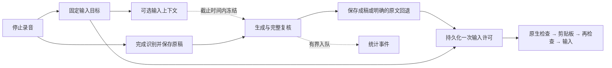

# SpeakMode 链路简化与质量对照（2026-10-28）

## 结论与采用范围

本轮把输入目标、可选上下文、统计和协议选择的职责拆清，并修复对照实验发现的两处本地误拦截。确定性修改进入普通流程；精确保护和按风险跳过复核只保留为实验入口，没有用户开关，也没有改变普通流程的复核次数。

| 工作 | 本轮状态 | 证据与边界 |
| --- | --- | --- |
| 输入目标与可选上下文分开就绪 | 已实现 | 阻塞上下文的协调器测试中，目标仍能交付一次；冻结后的迟到上下文丢弃 |
| 合并重复目标检查 | 已实现 | 普通成功输入路径从协调器一次、原生层两次，收敛到原生层两次；剪贴板前后检查保留 |
| 移走同步统计等待 | 已实现 | 复用有容量限制的数据库队列；事件失败与队列拒收标记统计不完整，成稿保存仍可继续 |
| 日期改口、跨句字母误拦截 | 已修复 | 本地正反例与同批模型用例均通过；没有放开全文语义复核 |
| 缩小英文逐字保护 | 完成初步对照，未启用 | 长混合口述的英文重复得到清理，但样本少、部分长文更慢且仍有指令残留 |
| 按风险跳过复核 | 完成影子评估，未启用 | 8 个输入中只有原样短聊天符合候选条件；两组实际都执行完整复核 |
| 收敛协议与状态 | 已实现职责收敛 | 一个协议选择器；一个资源释放判断；交付协调移到独立模块。既有供应商范围和来源／成稿／交付状态边界保留 |

## 实际链路

### 目标与上下文

- `target_capture_pending` 只表示输入目标尚未准备好；新增 `input_context_capture_pending` 表示可选上下文读取尚未结束。
- 先发布输入目标、应用身份和目标失败原因，再读取周边文本。原生目标操作与上下文读取原本已有不同的执行线程，本轮解除的是协调器中的就绪依赖。
- 整理仍可在既有绝对截止时间内等待最多 600ms 的可选上下文；自动输入只等待目标。没有增加模型等待预算。
- 退出、新录音等资源所有权判断仍等待两个任务结束。取消、删除、代次变化和输入上下文冻结后，迟到结果不能重新绑定到会话。
- 停止录音命令本身仍等待其原生检查任务返回；本轮不声称 IPC 立即返回，也不声称整个输入位置检测已异步化。

### 输入与统计

- `session_delivery.rs` 负责持久化许可、生命周期检查和回执；`platform::delivery` 负责剪贴板前后的目标验证。去掉保存许可之前那次重复原生验证。
- 不删除取消、用户主动移动焦点、目标身份、权限或单次许可检查。不自动重试未知结果；派发按键仍不是已确认插入。
- 普通整理不再 await 个性化统计写入。丢弃等待票据不会丢弃已接收的队列任务，也不创建游离异步任务。
- 统计写入和反馈不再触发整个配置／历史／使用量快照重读。关键保存仍使用数据库的关键任务通道。
- 统计与成稿共用数据库写线程，因此已经开始的 SQL 和磁盘锁仍可能影响后续任务；本轮移除的是同步依赖，不是承诺统计完全没有开销。

### 统计完整性与 schema 6

异步事件在进程被终止时可能尚未持久化。新增单行统计健康表：启动标记运行中，正常退出在排空队列后清除运行标记；上次退出未确认、事件失败或拒收时，将统计视为不完整。标记跨重启保留，不能重启后显示一个看似完整但分母缺失的统计。

这是保守策略：意外退出也可能使实际上完整的统计显示为未知；目前没有自动重建或清除不完整标记的界面。已有原稿、成稿和逐项记录不删除，正常转写不依赖统计汇总可用。

数据库版本从 5 升到 6。旧 schema 5 应用会拒绝打开新版本数据库，不能把换回旧安装包当作数据回滚。本轮没有安装、启动用户应用或迁移用户数据库；模型实验仅用 SQLite 只读方式取模型配置。现有 0.2.32 候选包不包含这些修改，新安装包发布前还需更新桌面版本并检查升级／回退说明。

## 模型对照方法

- 固定输入：[pipeline-simplification-v1.json](fixtures/pipeline-simplification-v1.json)，8 个合成文本，涵盖聊天、否定、日期改口、字母与代码、邮件、3 个长混合口述。
- SHA256：`5e45aa0c5b68feb8b40cbb35fa0e76cb98c63756d2371fc1468996d82836f8c0`。
- 同一配置供应商 `aliyun`、模型 `qwen3.8-flash`，相同来源、场合、词典和正常初次整理预算。每个用例交替执行两组，未做跨日、跨供应商或多人试验。
- baseline：原有长中文中的整段英文保护；precise：实验性逐字引语、代码、词典匹配项、明显标识符及地址保护，普通英文允许整理。
- 两组都执行本地检查与完整语义复核；每组每例上限 4 次请求。每轮上限 64 次，实际各 32 次；两轮合计 64 次请求。
- 两轮使用同一固定输入。第一轮暴露本地误拦截后修复，再重跑第二轮。未在失败后删除用例、放宽时限或仅统计成功耗时。
- 每条结果和耗时见[可分享的合成评估记录](results/pipeline-simplification-2026-10-28.json)，含输入与可执行文件哈希、每阶段耗时、失败码和输出。原始本机 JSONL 另存于工作区外层 `output/`，未纳入 Git。

## 观测结果

“生成成功”仅表示本地检查和模型复核通过，不能直接解释为用户可直接采用。

| 轮次 | 组别 | 返回成稿 | 请求数 | 8 次尝试耗时中位数 | 最大观测耗时 |
| --- | --- | ---: | ---: | ---: | ---: |
| 修复本地规则前 | baseline | 5/8 | 16 | 3102.5ms | 8002ms（超时） |
| 修复本地规则前 | precise | 6/8 | 16 | 3367ms | 5982ms |
| 修复本地规则后 | baseline | 7/8 | 16 | 2676.5ms | 8007ms（超时） |
| 修复本地规则后 | precise | 8/8 | 16 | 3247.5ms | 7269ms |

### 直接落实的误拦截修复

1. **重复标签的相邻改口。** `预算三千，不对，预算三千五` 的旧预算以前仍留在“有效事实”中，正确草稿被要求保留两个值。现在只在相邻、显式重复相同非数值标签、同单位且没有否定／条件／历史变化时替换分析视图；原始识别内容和来源引用不修改。不同费用归属、带“可能／不是”的新值和中间隔着实质内容的情况不套用这条规则。
2. **字母要求的语句范围。** `我在看 A D H D 的研究。表格的四个选项分别是 A、B、C、D` 以前会把第二句的“选项”传播到前一句。上下文现在有语句边界，明确的“不要合并这些字母”等后续指令仍可回指；独立列表、重复字母和代码继续保护。

同一固定用例第二轮分别得到正确日期＋最终预算，以及 `ADHD`＋独立的 `A、B、C、D`。新增反例验证错误年份、错误最终预算、丢失否定、合并列表、修改代码仍被拒绝。

数值和作用域检查仍是有限规则，不是通用语义证明。例如“三千五”到数字金额的所有口语写法并未纳入本轮验收；当前用例保留了“三千五”的表达，不能把这一结果推广为金额数字化能力。

### 精确保护的收益与不足

- 两轮中 baseline 的长混合用例都保留了 `I I`、`and and`、`We we`；precise 能清掉这些重复，说明整段英文逐字保护确实会妨碍自然成稿。
- 第二轮 `mixed-long`：baseline 5088ms，precise 7036ms；`long-scope`：baseline 5235ms，precise 6701ms。不能据此声称精确保护提速。
- `long-literals`：baseline 两轮均在约 8s 超时；precise 两轮返回成稿，第二轮保留 `target_id`／`targetId`、合成 URL／邮箱和逐字引语。单个案例不是总体超时率结论。
- precise 的 `long-scope` 仍保留“这两处是说话时的重复，可以自然接起来”等口述说明。检查通过不等于自然程度已经达标。
- 目前仅 3 个长文本，未覆盖开放域专名、未知字母组、多供应商和真实录音。**不提升为生产默认策略。**

### 风险分流

影子规则只把“来源完整、草稿原样、无数值／条件／否定／改口、无特殊写作政策或结构化要求”的情况列为可能省略复核。本批只有 `clean-chat` 符合。实际请求没有省略复核，所以没有测得单次请求的实际质量或时延收益。影子判断仅在实验入口运行，普通转写不承担这次额外分析。

## 工程验证与剩余验收

| 检查 | 结果 |
| --- | --- |
| Windows/MSVC desktop library tests | 1082 passed / 0 failed / 4 ignored，46.05s |
| Desktop check | PASS，退出 0 |
| TypeScript `npm run check` | PASS，退出 0 |
| 阻塞／取消／panic 上下文任务 | PASS；目标可独立交付，迟到上下文不能修改冻结稿 |
| 统计 SQL 故障、丢弃等待票据、队列拒收及重启 | PASS；关键保存可继续，统计不虚报完整 |
| 固定文本真实模型请求 | 已执行，两轮各 32 次 |
| 真实微信、浏览器输入、真人录音与用户采用率 | NOT_RUN |
| 新安装包与真实用户数据库升级 | NOT_RUN |

缓存检查末值 11.964 GiB，上限仍为 12 GiB，没有扩大缓存预算或清理既有缓存。初始规则失败日志和新增队列测试中使用错误测试辅助方法导致的编译失败日志保留；修正后以上最终检查通过。

后续质量晋级应使用独立留出集与真实录音，分别量化可直接采用、事实／条件错误、指令残留和超时。当前最有价值的下一步是验证精确保护的专名保持与指令消除，而不是继续减少复核调用。真实应用自动输入仍需按目标应用核验，不能把本轮协调器测试当成微信问题已彻底解决。
