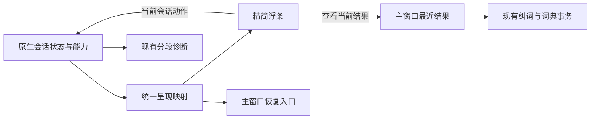

# SpeakMode 精简交互实施计划

日期：2026-11-05

状态：P1/P2 已实现，墨蓝视觉调整及代码清理已整合进 0.2.34 验证包。当前版本自动检查和打包通过；此前的合成界面及隔离原生设置检查范围单独保留。真实口述、跨应用输入和速度对照尚未验收。

源码基线：`d2de816`，`fix/dictation-reliability-20261028`。当前整合与提交范围见 [0.2.34 交付记录](../experiments/release-0.2.34-2026-11-05.md)。

## 1. 本轮要改善的体验

用户在正在使用的应用里按快捷键说话，再按一次结束，就能继续使用文字。正常口述不需要选择模式、检查参考或确认继续；发生问题时，已有内容可恢复，用户知道下一步做什么。

设计基线为 [精简交互原型](D:/Codex_Project/SpeakMode_Dev/reports/prototype-simple-2026-11-05/README.md)。本次按照计划默认值实现**固定浮条**，字幕作为默认关闭的可选能力。随输入框定位安排在固定浮条完成原生验收之后。

产品继续沿用现有颜色、字体、用户配置的快捷键和模式。右 Alt 是默认快捷键，已有自定义快捷键继续生效。原型的示例聊天、发送按钮、顶部方案切换器与演示设置属于测试环境。

首期覆盖四个入口：录音浮条、失败恢复、最近结果、相关设置。主窗口沿用已有导航和今日概览，最近结果优先呈现正文与复制/纠词。完整的词典、模式、个人风格和服务配置继续从现有入口访问。截图理解、本地 ASR、模型切换、自动学习词条属于独立工作。

## 2. 已有能力和实际差距

| 当前代码 | 已有基础 | 本轮真正需要改的部分 |
| --- | --- | --- |
| `RecorderWindow.tsx`、`CaptionStrip.tsx` | 模式菜单、实时声波、字幕、取消、结束、错误复制 | 默认浮条移出模式标签、自动字幕和参考详情；状态、文案和可执行动作统一映射。 |
| `useRecorderSize.ts`、`desktop.rs` | 原生无激活窗口、尺寸约束、多屏工作区定位、模式菜单焦点处理 | 收敛默认尺寸；动态展开恢复/字幕时保持锚点，不抢焦点；避免前端和原生分别决定何时隐藏。 |
| `session_delivery.rs`、`deliveryFeedback.ts`、`SessionRecovery.tsx` | 一次性投递、持久化投递记录，正常派发后安静收起 | 保留正常安静结束；明确部分输入、回执失败、整理回退等需要注意的情况，统一浮条和主窗口口径。 |
| `HistoryDetail.tsx`、`TermCorrectionPanel.tsx`、`store.rs::correct_term` | 精确选区、版本检查、纠词与可选词典写入的事务 | 把入口和表单做轻；原有校验、冲突处理和词典语义继续复用。 |
| `session.rs`、`app_writing.rs` | 目标先发布，可选参考后读取，参考按目标及 3 秒时效冻结 | 验证慢参考不会拖住完成/下一轮；仅对实测问题修改等待和资源释放。 |
| `diagnostics.rs` | 启动、首字幕、最终识别、整理、保存、原生投递回执等分段计时 | 复用现有诊断，补缺失的阶段与端到端验收口径；字幕关闭时不伪造渲染时间。 |
| `rewrite_fallback.rs`、`rewrite.rs::initial_wait_ms` | 完整识别稿的整理失败回退；初次整理预算为 ≤400 字 5 秒、401–800 字 8 秒、更长 20 秒 | 首批保持策略；后续依据真实分段数据评估调整，而非先降低上限或移除语义保护。 |

当前 Windows 派发结果映射为 `Skipped`、`Failed` 或 `Unconfirmed`。协议虽有 `Confirmed`，当前这条执行路径不产生目标应用确认。原型中的“已填入”来自可观测的示例文本框，正式产品不能把派发回执改称目标已收到。

## 3. 默认交互及状态约定

### 正常路径

1. 快捷键开始：显示小浮条。原生录音尚未就绪时呈现启动反馈，收到采样后才显示正在听的声波。
2. 说话：默认只显示取消、声波/简短状态、结束。模式沿用既有设置；本次模式仍可从托盘入口修改，其作用范围仍为本次会话。
3. 再按快捷键：停止收音，进入简短处理状态。用户可取消；界面不要求继续确认。
4. 正常完整派发：沿用安静收起，不增加成功弹窗或重复输入。记录里保留真实的投递状态。
5. 需要查看识别内容时，在设置启用单行字幕；保留现有字幕修订、尾部跟随和读取快照能力。

### 需要用户处理的情况

| 条件 | 用户看到的内容 | 主动作及约束 |
| --- | --- | --- |
| 目标改变、不可编辑或找不到目标 | 输入位置变了，文字已保留 | 复制文字；次要入口查看结果。不会自动换目标或再次粘贴。 |
| 部分输入、派发失败或回执保存失败 | 请先核对输入框，文字已保留 | 查看/复制；提醒已有部分内容，避免暗示可以安全自动重输。 |
| 完整识别稿存在，但整理超时/不可用 | 整理未完成，识别原文已保留 | 继续沿用既有一次性派发策略；提示是否只尝试输入，避免无依据的“已填入原文”。 |
| 识别不完整、音频或服务失败 | 简短说明，保留已有文字或可重试音频 | 由 native 的 `canRetry*`、`canCopyRecovery` 等能力选择一个主动作；更多操作进入主窗口。 |
| 原文或结果保存失败 | 文字尚未保存，请重试 | 优先重试保存；不能显示完成或清理尚未安全保存的内容。 |

“收起”只隐藏当前提示，遵守现有保留期限及用户历史保存设置；“取消口述/放弃恢复”才走相应的取消或清理语义。正常过程保持两个必需操作，异常恢复不强迫重新口述。

## 4. 组件边界与接口改动

### 呈现层

- 新增纯函数模块 `app/src/services/recorderPresentation.ts`，输入 `LiveSession`、偏好和原生能力，输出用户状态、短文案、主/次动作、字幕是否显示、是否需要保持提示。
- 用户层按待机、正在听、正在处理、结束、需要处理组织，启动未就绪作为正在听之前的短暂呈现分支。`结束`不等于投递确认。
- `RecorderWindow`、主窗口恢复入口共享这套映射。命令仍经 `DesktopProvider` 发送，并绑定 sessionId/generation；前端不产生新的引擎状态，也不以定时器模拟真实完成。
- 模式菜单抽为独立组件，保留托盘请求与焦点归还协议。默认工具条不占用一整块模式选择区域。
- `CaptionStrip` 复用现有字幕逻辑，由偏好控制挂载/可见性。隐藏时其渲染代理耗时为空或“不适用”，不是 0，也不代表 ASR 延迟。

### 原生窗口与结果导航

- 原生继续拥有最终显示/隐藏与工作区位置。前端只申请尺寸；可选的短动画不得反向阻塞录音、停止或投递。
- 增加窄用途的 `window.dismissRecorder`：校验当前会话身份，仅在终态/恢复态隐藏提示，不取消引擎、不删除缓存。迟到的旧请求不能隐藏新录音。
- 在现有 `app.showMain` 上增加“查看当前结果”的导航意图，当前会话 ID/代次由 native 校验；主窗口通过既有导航保护打开对应记录或临时结果。浮条不获得任意历史记录修改能力。
- 主窗口打开不得自动恢复原投递资格。用户切换窗口、修改草稿后，后续重试结果仍走现有查看/复制路径。
- 原生完成策略同时处理 `partialInputUnconfirmed`、保存错误、回退标记。当前一般 `Unconfirmed` 的安静结束策略保留。

### 设置与数据

- 新增一个呈现偏好，例如 `recorderCaptionsEnabled`，默认关闭；联动 `contracts.ts`、`preferences.ts`、Rust `Preferences`、设置更新与持久化校验。
- 旧配置缺失此字段时由新版本提供默认值，保留用户现有模式、快捷键、历史保存和上下文设置；使用现有 preferences.version 并发校验。
- Rust 偏好反序列化当前使用 `deny_unknown_fields`。增加字段后不能假设旧二进制仍能直接读取新配置。回退优先使用保留新数据格式的修复版本；二进制降级需先验证配置/数据库可读性，不能通过重置用户配置解决。
- 原生按实际选择生成 `WritingReceipt`；最近结果按需显示本次参考、回退与记忆回执。上下文关闭不代表没有云端 ASR/整理；持久化记录不加入宿主正文或截图。
- 已有历史关闭模式、临时结果、恢复过期和“记住词条”行为继续生效。纠词仅修改选中位置，默认不勾选记忆；撤销正文修改仍不删除已保存词条。

## 5. 分批实施顺序

每批形成可独立审查的改动与验证记录；以下是本地实施拆分，不代表已经创建提交或 PR。

| 批次 | 工作与主要文件 | 完成条件 | 依赖 |
| --- | --- | --- | --- |
| P0 基线与状态表 | 记录当前构建/配置及现有诊断；补齐状态→文案→动作→可见性对照表，覆盖不完整输入、回退、取消 | 固定使用样例、观测字段和失败条件；现有实现/未知项明确 | 无 |
| P1 精简浮条 | `RecorderWindow.tsx`、`recorder.css`、`recorderPresentation.ts`、`CaptionStrip.tsx`、`useRecorderSize.ts`、`desktop.rs`；字幕偏好及模式入口 | 默认紧凑，快捷键开始/结束，字幕可选；浏览器与原生窗口均不抢焦点、不裁切；取消不晚到落字 | P0 |
| P2 恢复与最近结果 | `deliveryFeedback.ts`、`SessionRecovery.tsx`、`RetainedRecovery.tsx`、`session_delivery.rs`、`engine/mod.rs`、`App.tsx`、`HistoryDetail.tsx`、`TermCorrectionPanel.tsx` | 收起与放弃区分；异常文字可取回；查看当前结果准确；一次纠词、可选记忆；正常路径无恢复卡片 | P1 |
| P3 有证据的延迟优化 | `diagnostics.rs`、`session.rs`、`app_writing.rs`、`rewrite_fallback.rs`；必要时才改网络客户端或整理执行 | 对固定样例做前后对照，处理耗时下降且原意、纠错次数、回退率和输入可靠性不恶化 | P0，P1/P2 验收记录 |
| P4 原生验收与交付 | 现有 helper、Rust 检查、真实目标应用验收、安装包与验收记录 | 完整流程和数据升级通过，失败清单可追溯，打包版本能复现已验收代码 | P1–P3 |

P1 的第一组实际修改从统一呈现映射和固定浮条开始，同时做原生焦点小范围验证；不能等全部界面做完才第一次检查 Windows。P3 先利用已有分段计时确定瓶颈，一次只改变一种等待/调度策略。

## 6. 后台速度的处理方式

诊断继续使用 Rust 单调时钟、会话关联和有限内存缓冲。原有计时至少覆盖：热键/命令到采样、首字幕、停止到最终识别、整理往返、停止到结果提交、停止到原生派发回执。只补目标捕获、可选参考读取或其他实际缺失的阶段，不平行建设另一套埋点。

注意两种时间：`stop_to_native_delivery_receipt_ms` 是引擎取得派发回执的时间；用户可使用文字的时间需观察真实目标输入框。二者分别记录。字幕隐藏时，不用字幕渲染代理来判断首个状态反馈是否快。

优化优先级：可选参考/非必要工作是否占用关键路径 → 客户端和资源初始化是否重复 → ASR 结束与尾包等待 → 整理调用与检查预算。已有目标/参考解耦、取消令牌和一次性投递机制继续保留。取消、不完整原稿不能转为自动原文投递；已提交的投递记录和必要保存不能为降低数字而跳过。

前一份技术草案中的约 100 ms 启动反馈、短句 P50 1.5 秒/P95 3 秒，仍是待校准的体验目标。P0/P3 报告会区分启动反馈、采样开始、可用文本，并按设备、提供商和网络分组；原型 650 ms 不是性能依据。正式验收门槛在基线实测后冻结。

## 7. 验证矩阵与交付门槛

### 自动与浏览器检查

- 状态映射的表驱动检查：启动、录音、ASR 收尾、整理、正常未确认派发、部分输入、回退、目标改变、保存失败、取消、迟到事件；重点检查动作资格及不会误报“已填入”。
- 复用字幕、波形、投递反馈、选区及纠词 helper；更新受本轮交互变化影响的用例，不为纯样式细节堆叠测试。
- 复用原生取消、delivery、recovery、rewrite deadline/fallback 测试；新增收起与取消分离、旧请求不能隐藏新会话、字幕偏好读取/保存用例。
- 使用生产组件与合成 IPC 检查正常路径、错误恢复、键盘和 reduced-motion。浏览器测试继续与原生输入证据分开记录。
- 仓库现有构建入口：`npm.cmd --prefix app run check`、`npm.cmd --prefix app run build`；原生使用 `scripts/build-desktop.ps1 -Task Check -ValidateOnly`，通过环境预检后执行 Check/Test，最后 Package。

### 真实 Windows 验收

固定同一组中文素材：简短聊天、技术名称/中英混合、数字日期/否定条件、长段口述。短句约 5–20 秒，同时加入长于 400 字的样例。每种条件保留样本数、失败、重试与回退；小样本分位数只作探索观察。

| 维度 | 至少覆盖的条件 | 可接受结果 |
| --- | --- | --- |
| 目标应用 | 自有可编辑测试控件、浏览器输入框、微信草稿、编辑器 | 文字进入指定位置；正常验收不自动发送真实消息 |
| 已有输入 | 有草稿、选区替换、结束后继续打字、切换窗口 | 不覆盖新输入、不投到错误窗口、不重复插入 |
| 录音控制 | 默认和自定义热键、连续两轮、取消后立即再录 | 不漏首字尾字，旧事件不影响新轮次 |
| 窗口呈现 | 100%/150%/200% DPI、不同屏幕工作区、长错误文本、字幕开关 | 不抢焦点，不遮挡主操作，不裁切，也不因展开而跳动 |
| 故障 | ASR 失败、整理超时、不可编辑目标、部分输入、保存失败 | 只提供确实可执行的恢复动作；已有内容按保留策略可取回 |
| 数据 | 新配置、旧配置升级、历史关闭、纠词冲突、词典已满 | 原配置保留；临时正文不会因纠词意外持久化；正文与词典事务一致 |

首期交付必须满足：正常路径只需开始和结束，不新增模式/参考确认；验收用例无错窗口输入、重复输入或取消后落字；数字、人物、日期和否定条件保留；异常可以恢复；前后对照的用户总完成时间和补救操作没有因界面简化恶化。性能更快需有真实输入结果及计时支撑，不能只以测试通过或动画更短宣称。

## 8. 当前交付状态

| 批次 | 本次执行状态 | 剩余验收 |
| --- | --- | --- |
| P0 | 已核对正式源码、完成状态映射和自动回归基线 | 真实设备/网络下的速度基线仍为 NOT_RUN |
| P1 | 统一呈现、274×48 浮条（原生基础窗口 298×68）、字幕偏好、托盘模式入口已接入 | 实际录音浮层的焦点、多 DPI/多屏及连续两轮口述未实测 |
| P2 | 收起与取消分离、当前结果导航、精简恢复/纠词界面已实现 | 真实目标输入框恢复、历史关闭情况下的端到端用户任务未实测 |
| P3 | 已审阅现有目标/参考分离、整理期限、完整性检查与一次性派发；本轮保持这些策略 | 没有真实前后计时数据，未调整模型/等待预算，也不宣称速度提升 |
| P4 | TypeScript、生产构建、1086 项 Rust 测试、58 项 helper 检查通过；合成界面及隔离原生设置检查完成；EXE/NSIS 0.2.33 已生成 | 麦克风、云端、跨应用输入、多屏/DPI、安装/升级和用户总完成时间仍为 NOT_RUN |

完整证据与限制见 [0.2.33 执行记录](../experiments/simplified-dictation-2026-11-05.md)。浏览器使用生产构建与合成 IPC，原生 UI 使用独立测试配置，没有改动既有用户资料或安装现有版本。验证包已经可以交付，发布验收尚未完成。

## 源码定位

- [RecorderWindow.tsx](../../app/src/windows/RecorderWindow.tsx:22)、[CaptionStrip.tsx](../../app/src/windows/CaptionStrip.tsx:27)、[useRecorderSize.ts](../../app/src/windows/useRecorderSize.ts:8)
- [desktop.rs](../../app/src-tauri/src/desktop.rs:338)、[session_delivery.rs](../../app/src-tauri/src/engine/session_delivery.rs:69)、[deliveryFeedback.ts](../../app/src/services/deliveryFeedback.ts:32)
- [SessionRecovery.tsx](../../app/src/components/SessionRecovery.tsx:14)、[HistoryDetail.tsx](../../app/src/components/HistoryDetail.tsx:21)、[TermCorrectionPanel.tsx](../../app/src/components/TermCorrectionPanel.tsx:15)
- [diagnostics.rs](../../app/src-tauri/src/engine/diagnostics.rs:114)、[session.rs](../../app/src-tauri/src/engine/session.rs:382)、[rewrite.rs](../../app/src-tauri/src/cloud/rewrite.rs:427)
- [Preferences](../../app/src-tauri/src/core/types.rs:49)、[录音窗口命令边界](../../app/src-tauri/src/engine/mod.rs:313)
